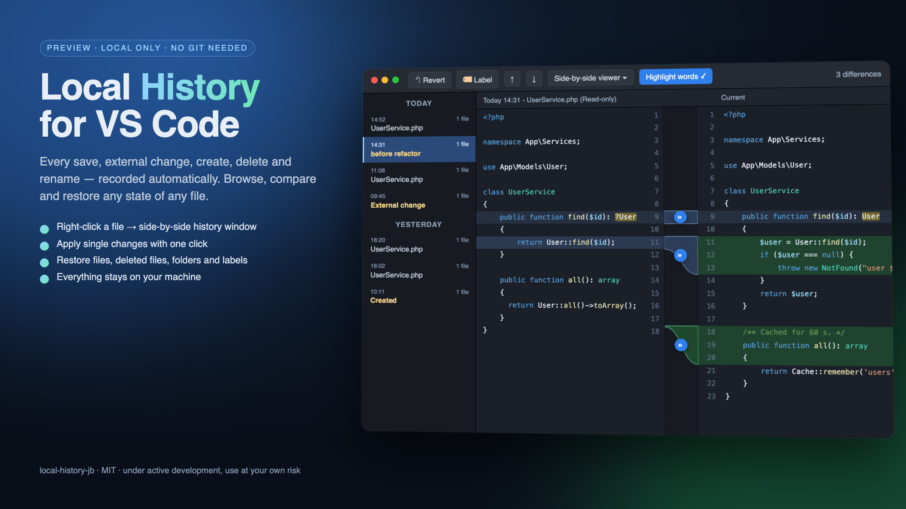

# Local History for VS Code



> ⚠️ **Preview — under active development. Use at your own risk.**
> This extension keeps copies of your files in local storage and can overwrite or delete workspace files when you restore. It is tested, but young: keep using Git (or another backup) for anything you cannot afford to lose, review every restore preview, and report problems to the author. Nothing is uploaded anywhere; all data stays on your machine.

Automatic, Git-free local history for every file in your workspace. Every save, external change, creation, deletion and rename is recorded. Right-click a file to open its history window, compare any revision with the current file side by side, apply single changes, restore whole files or deleted files, and put labels before risky edits.

## Install

Requirements: VS Code **1.103 or newer**, desktop (macOS, Linux or Windows — the same file works on all). No account needed.

### From the downloaded `.vsix` file

1. Open VS Code.
2. Open the Extensions view: `Ctrl+Shift+X` (Windows/Linux) or `⇧⌘X` (Mac).
3. Click the `…` button in the top-right corner of the Extensions view.
4. Choose **Install from VSIX…**
5. Select the downloaded `local-history-jb-<version>.vsix` (usually in your Downloads folder) → **Install**.
6. When prompted, click **Reload Window** (or restart VS Code).

**Alternative (drag and drop):** drag the `.vsix` file from Finder/Explorer and drop it onto the Extensions view.

**Alternative (terminal)**, if the `code` command is available:

```bash
code --install-extension ~/Downloads/local-history-jb-0.1.0.vsix
```

**Updating:** install the newer `.vsix` the same way; a higher version replaces the old one. Your history is kept.

**Uninstall:** Extensions view → *Local History (IDE-style)* → Uninstall. Recorded history stays in the storage folder (see **Open Storage Folder**) until you delete it.

## Using it

1. Open a folder. Tracking starts immediately; nothing is written inside your workspace.
2. Edit and save a file — that creates its first revision.
3. **Right-click the file → Local History.** The history window opens (in its own floating window by default; set `localHistory.popup.newWindow` to `false` for an editor tab):
   - **Left:** revisions grouped by day — time, event (Saved, External change, Created, Deleted, Renamed…), labels.
   - **Right:** the selected revision (read-only) next to the **Current** file. Syntax colours, changed lines tinted, word-level highlights, line numbers next to the centre gutter, both sides scroll together.
   - **Centre gutter:** coloured bridges connect each change on both sides; click the **»** button on a bridge to copy that change into your editor (the file becomes unsaved — nothing is written until you save).
   - **Toolbar:** ↶ **Revert** (whole file to the selected revision, a safety snapshot is kept), 🏷 **Label**, ↑/↓ previous/next difference, *Side-by-side* / *Unified* viewer, *Highlight words*, difference counter.
4. **Right-click a folder → Local History** shows a popup list of that folder's revisions and deleted files, with one-click restore.
5. **Explorer → Local History** sidebar: the same data as a tree that follows the active editor, with filters (event type, labels, content search, time range) and a workspace-wide view.

### Restoring

Every restore first records a safety snapshot of the current content, so a restore is always reversible from history (the notification offers *Undo*). Restores bypass format-on-save so the content equals the revision exactly. Folder and label restores show a multi-file preview and a confirmation with counts; files created after the chosen point are deleted but remain recoverable from **Deleted files**.

### Labels

**Local History: Put Label…** records a named checkpoint for a file, folder or workspace. Unsaved editors in scope are snapshotted first, and for file/folder labels, not-yet-tracked files in scope are snapshotted too (up to `localHistory.labelSnapshotLimit`). Labels can be compared with the current state, restored, renamed or deleted; the revisions they mark are never removed by cleanup.

## Storage, privacy and retention

- Location: VS Code's global storage for the extension, or `localHistory.storagePath`. Command: **Local History: Open Storage Folder**.
- Metadata in SQLite; snapshots as SHA-256 content-addressed, gzip-compressed blobs with owner-only permissions. Identical content is stored once.
- Writes are atomic; the database is integrity-checked on start and a corrupt database is moved aside, never deleted.
- Retention (`localHistory.retentionDays`, default 5) counts **days on which the file changed**, not calendar days. `localHistory.maxStorageMB` caps total size. Pinned revisions, label checkpoints and the newest revision of each file are never removed. Cleanup logs what it removed (**Show Log**, **Show Storage Statistics**, **Run Cleanup Now**).
- Secrets never enter history by default: `.env*`, keys, certificates, credential files, `.npmrc`, `.netrc`, `.aws/`, `.ssh/`, … plus `.git`, `node_modules`, build outputs and caches. Add patterns with `localHistory.exclude`, force-track with `localHistory.include`, or honour `.gitignore` with `localHistory.honorGitignore`. **Forget History for This Path…** purges anything recorded by mistake.
- No telemetry, no network access, no data leaves the machine.

See `docs/CONFIGURATION.md` (bundled) for every setting and command.

## Known limitations

- Entries do not appear in VS Code's built-in **Timeline** view (that API is not available to extensions).
- Unsaved edits are not snapshotted; a revision is created on save.
- Changes made while VS Code was closed are recorded as *external change* the next time the file is opened or touched; there is no startup scan.
- Binary files and files above `localHistory.maxFileSizeKB` (1 MB) are skipped.
- Syntax colours in the history window use a fixed palette, not your editor theme.
- Tested on macOS; Windows and remote (SSH/WSL) setups are not yet verified.

## Development

```bash
npm install
npm run check            # typecheck + lint + unit tests
npm run test:integration # real extension host
npm run package          # production build + .vsix
```

## License

MIT
